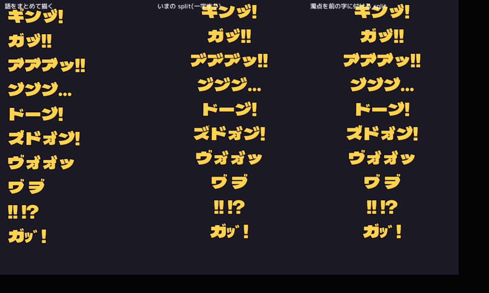

# 擬音を濁点で強める書き方(調査)

ken 2026-10-19 の相談「ギンッ! の ッ に濁点を付けるような、擬音をさらに強める漫画の書き方」を調べた。決まりの本体は `design/2026-10-17-onomatopoeia.md`(プロジェクトの設計メモ)。

## 1. 結論

- 本来は濁らない字(母音、ッ、ン、ー)に濁点を付けるのは、漫画やネットで定着した**書き言葉だけの強調**。読み方は決まっておらず、声や音が「力んで濁る」「喉の奥でつぶれる」感じを足す。
- ゲームのフォント(Dela Gothic One)は、合成用の濁点 U+3099 を**きれいに字に重ねて出せる**(下の写真)。ギンッ゙! の ッ゙ はそのまま使える。
- ただし、いまの描き方(`CueText.split` が一コードポイントずつ切る)では、濁点が**別の字として動く**。動きのある擬音で使うには、濁点を前の字にくっつける直しが一行要る。
- 使うのは「!」で終わる、いちばん重い擬音だけにしぼるのがよい。どこにでも付けると、強さの段が無くなる。

## 2. 漫画・創作での使われ方(調べたこと)

| 効果 | 例 | 出典 |
|---|---|---|
| 苦痛・驚き・奇妙さの強調(全部の字に付ける) | い゛だい゛わ゛ぁ゛ぁ゛ぁ゛!!! | ニコニコ大百科「゙」 |
| 深刻な驚き・焦り | え"っ!(えっ! より深刻) | 和語の里 |
| 力み・食いしばり(力を込めると声が濁る) | オ"ラ"〜〜! | 和語の里 |
| 怒り・ドスの効いた声 | 俺が作ってやﾞるﾞァﾞア!! | 和語の里 |
| 苦しくて声がはっきり出ない | あ"〜〜っ! | 和語の里 |
| 喉の奥から出るくぐもった声(風呂で「あ゙〜」) | あ"〜、い"い"湯だ〜 | 和語の里、Wikipedia「あ゙」(鬼怒川温泉の看板) |
| 叫び声(漫画の例) | あ゛あ゛〜〜〜〜ッッ!!!(日常)、ア゛ーーッ(鬼滅の刃の善逸) | Japanese with Anime |
| 唸り・喉で鳴らす音 | ん゙ | Wikipedia (en) Dakuten |
| 全部の字に濁点(怒りで声がゆがむ) | こ゛ろ゛す゛ | Japanese with Anime |

まとめると、濁点を足す型は三つ。

1. **一字だけ**(え"っ!、ギンッ゙!): 要の一字を濁らせて、一段だけ強くする。
2. **全部の字**(い゛だい゛わ゛ぁ゛): 声そのものがゆがむ。叫び・怒り・苦痛。
3. **伸ばしと組む**(あ゛あ゛〜〜ッッ!!!): 濁点 + 長音 + ッの重ね + !の重ねで、最大の叫び。

「ッ」に濁点を付ける例は、Web では作例の解説がほとんど見つからなかった(使われているのは確かだが、型としての説明は母音の濁点が中心)。意味は 1 の「一字だけ」と同じで、「止まる瞬間に力がこもる」と読むのが自然(推測)。

ほかの強調の作法(ゲームに既にあるものも含む):

- 「!」を重ねる(!!、!!!)、「!?」。フォントに ‼ ⁉ の字もある。
- 「ッ」を重ねる(ッッ)。止まる瞬間を長く・強くする。
- 長音・小書き文字で伸ばす(どかーーーーん、ゴォォッ)。
- 半角カナで小さく・かすかに(ﾌｯ)。濁点の逆の向きの調整。

## 3. フォントで出るか(確かめた)

Godot 4.7.1 で描いた。左は語をまとめて描いたもの、中はいまの `CueText.split`(一字ずつ)、右は濁点を前の字にくっつけて切ったもの。どれも `UI.cue_font()`(Dela Gothic One)で、中と右は `CueText.draw_word` の pop。

- **U+3099(合成用濁点)**: 字形があり、字に重ねる位置の情報(GPOS の mark)もある。ッ゙ は小さいツの右上に大きめの濁点が乗り、漫画の ッ゙ に近い。
- **U+309B(単独の ゛)**: このフォントには**字形が無い**。データには U+3099 を使う。
- **半角の ﾞ(U+FF9E)**: 出るが、隣に離れて並ぶ(写真の最後の行「ガｯﾞ!」)。強調には向かない。
- ヷ・ヺ(濁点付きのワ・ヲ)、‼・⁉ もある。

気になった点:

- **ン゙ はジに見える**(写真の「ン゙ン゙ン゙…」「ドーン゙!」)。このフォントの ン と ソ・シ は形が近いので、ン゙ は避ける。
- **ア゙ は一字ずつ描くと、ブ に見えやすい**(中の列)。濁点の位置が少し内側に入るため。
- いまの `CueText.split` は濁点を独立した一字にする。`draw_word` は字ごとに位置・回転・遅れをつけるので、bounce・stretch・drop・roll・fly では**濁点だけが遅れて出たり、別に跳ねたりする**(コードから読んだ推測。pop の静止画では目立たない)。直しは `split` で U+3099・U+309A を前の字に足すだけ。

## 4. ゲームでの使い方の案

- **強さの段を一つ増やす**: いまの「ッ」「!」の上に、「ッ゙」を最上段として置く。使うのは「一撃の重さ」を見せたい少数だけ。
  - 層の主の吹き飛ばしの一撃 ズドォン! → ズドォン゙! は ン゙ がジに見えるので不可。**ズドォッ゙!** に変えるか、そのまま。
  - 溜めの一撃 ドンッ! → **ドンッ゙!**
  - 魔物の突進が当たる ドカッ! → **ドカッ゙!**
  - 擬態から飛びかかる ガバッ! → **ガバッ゙!**
  - 武器の技で守りを割る バキッ → **バキッ゙!**
- **叫び・咆哮は全部の字に**: 層の主の咆哮(第1層の ギィィィィィィィッ!! など。`scripts/layer_boss.gd`)を ギィ゙ィ゙ィ゙ィ゙ィ゙ィ゙ィ゙ッ゙!! のように。声がゆがむ型(2)に当たる。画面いっぱいの文字なので、濁点も大きく見える。
- **くぐもった声**: 腹を下す ギュルル… や、休んで力が抜ける場面には、母音の濁点(あ゙〜)が合うが、いまは該当する擬音が少ない。足すなら「宿に泊まる」「温かい空の座」など。
- **自動で強める**: 「強め」の印を付けた擬音だけ、最後の ッ に濁点を足す、という出し方もできる(Sfx.cue の中で処理。CUES の文字は変えない)。いまの Sfx.cue には強さの引数が無いので、足すなら引数か別の id にする。

## 出典

- [ニコニコ大百科「゙」(濁点)](https://dic.nicovideo.jp/a/%E3%82%99)
- [え"っ!・あ"〜〜っ! などの創作物に見られる濁点の効果(和語の里)](https://onbin.hateblo.jp/entry/dakutenn_01kouka)
- [Wikipedia「あ゙」](https://ja.wikipedia.org/wiki/%E3%81%82%E3%82%99)
- [Wikipedia (en) Dakuten and handakuten](https://en.wikipedia.org/wiki/Dakuon)
- [Japanese with Anime: Dakuten](https://www.japanesewithanime.com/2017/12/dakuten.html)
- [ピクシブ百科事典「濁点」](https://dic.pixiv.net/a/%E6%BF%81%E7%82%B9)

## 実験室に取り込んだもの
- 「ッ に濁点」ボタン(U+3099 を最後の ッ に足す)と、実験の「濁点を前の字にくっつけて一字として動かす」(`CueLab.splitGrapheme`)。ゲームの `CueText.split` にはまだ入れていない。
